# jade-edu

Interactive courses from one JSON file, as lazy-loaded ES modules you can load from a CDN. Part of the
[Jade Agent Stack](https://github.com/lucky-edgelord/jade-agent-stack).

A course gets:

- **Lecture slides with a talking teacher.** Jade by default. She reads each slide aloud with the browser's voice, or shows captions when there is no voice. She blinks, moves her mouth on each word, and changes expression with the text.
- **Animated concept maps.**
- **Quizzes** that she reads and answers.
- **A reading view.**
- **Practice labs:** fill in the blanks, put in order, match, write, JavaScript, Python on MicroPython, a scripted terminal, and any webxdc app.
- **Flashcards.**
- **A final exam.**
- **Progress** saved on the device.

It is the Lilith Learning Lab formula, generalised. The pure modules are ported from that project by `tools/port.py`, and its `lilith-course` files still load.

## Use it

```html
<script type="module" src="https://cdn.jsdelivr.net/gh/lucky-edgelord/jade-edu@<ref>/src/edu.js"></script>
<jade-course src="my-course.json"></jade-course>
```

Use a tag or a commit for `<ref>`, never a branch. The exact pins for each stack release are in jade-agent-stack's `STACK.md`.

| Attribute | |
| --- | --- |
| `src` | URL of the course JSON |
| `teacher` | `jade` (default) or `none` |
| `model`, `core` | a Live2D teacher: the `.model3.json` URL and the Cubism Core URL |
| `voice` | `auto` (default) or `off` (captions only) |
| `chapter` | open this chapter (id or number) instead of the last one visited |

From JavaScript:

```js
import { mount, validate, configure, registerTeacher, useStackTheme } from 'https://cdn.jsdelivr.net/gh/lucky-edgelord/jade-edu@<ref>/src/edu.js';

const player = await mount(document.querySelector('#course'), 'course.json', {
  teacher: 'jade',                       // or { kind: 'live2d', model, core, expressions, motions, zoom, yoffset }
  voice: 'auto',
  onEvent: (e) => console.log(e),        // open, chapter, quiz, lab, lecture-done, exam, error
});
player.state();                          // { course, chapter, tab, progress, saved }
```

The same events are dispatched on the host element as a `jade-edu` CustomEvent. An agent can listen for them, for example to notice a failed lab and offer help.

### What loads when

`edu.js` is a few kB. The rest is imported the first time it is needed:

| Piece | Loads when |
| --- | --- |
| `player.js`, `style.js` and the pure modules in `core/` | a course is shown |
| `labs.js` | Practice opens |
| `core/xdc.js` | a webxdc lab opens |
| Jade's frames | per expression, the first time she shows it |
| MicroPython | the first Python run. It is the same build that jade-vn-engine runs its scripts on, from the engine's pinned CDN path |
| KaTeX | the course has math |
| Live2D | the Live2D renderer comes from jade-vn-engine's pinned CDN path. You supply the Cubism Core |
| Fonts | Rajdhani, Chakra Petch and JetBrains Mono, from the same CDN that jade-agent-ui-ux uses |

Change any of these with `configure({ python, engine, ui, katex, fonts })`.

## Screenshots and demos

Made by [`tools/docshots.mjs`](tools/docshots.mjs) from the example course, in the Vault look.

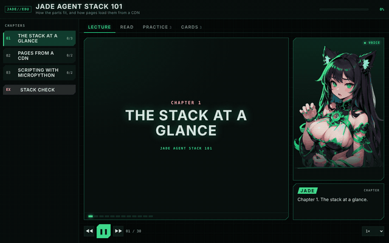

| | |
|---|---|
| 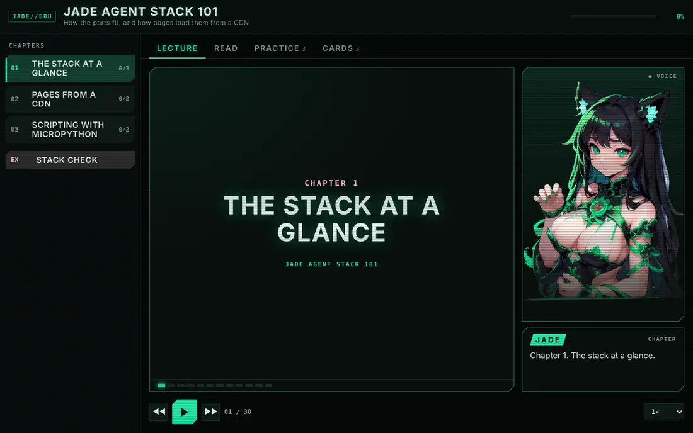<br>**Lecture**: slides, concept map, Jade narrating | 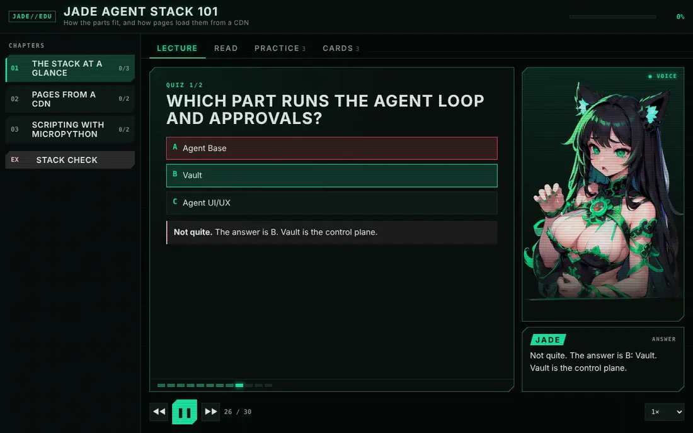<br>**Quiz slides**: feedback and an explanation |
| 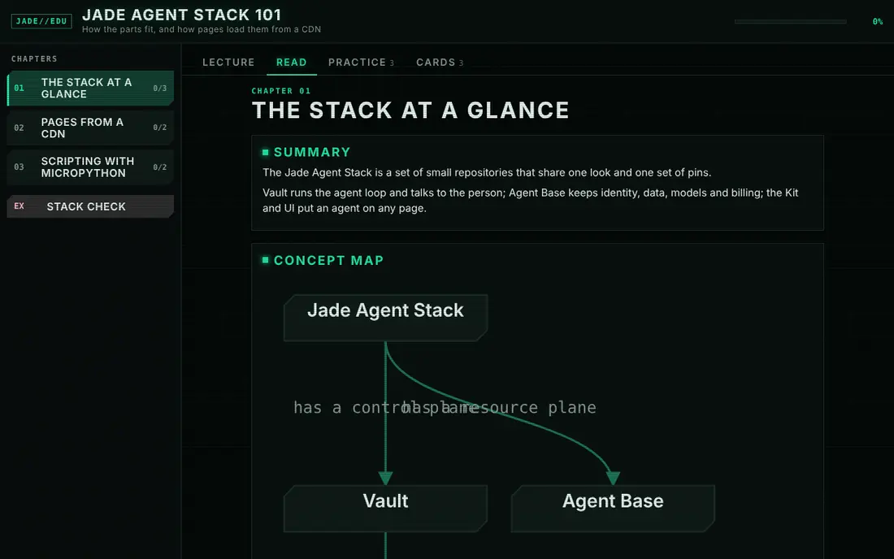<br>**Read**: the same chapter as a document | 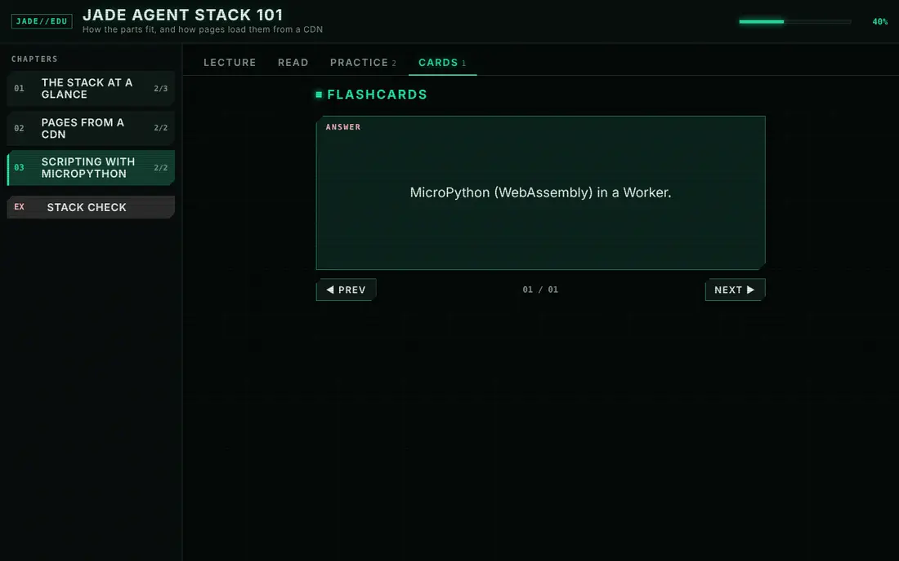<br>**Cards**: flip to the answer |
| 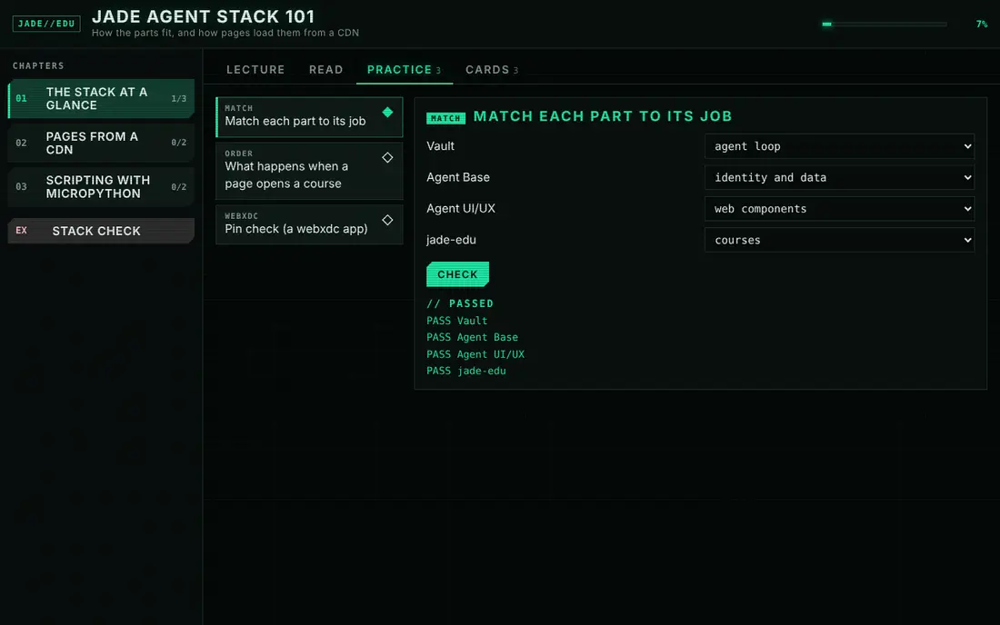<br>**Match lab** | 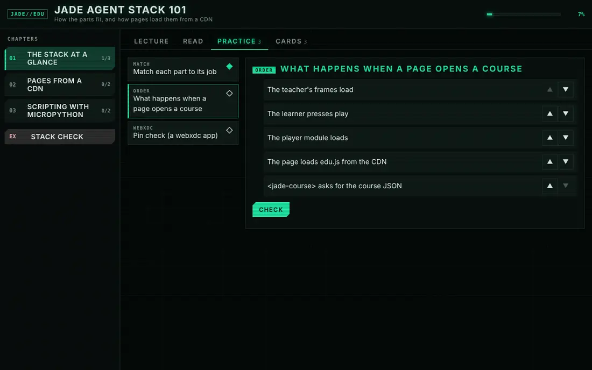<br>**Order lab** |
| 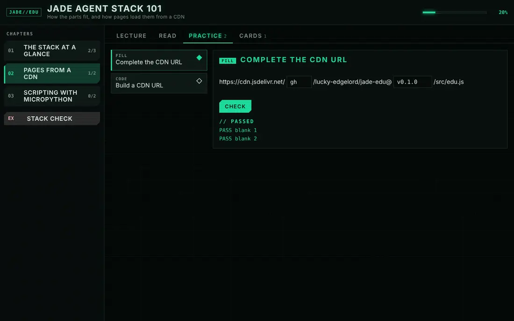<br>**Fill lab** | 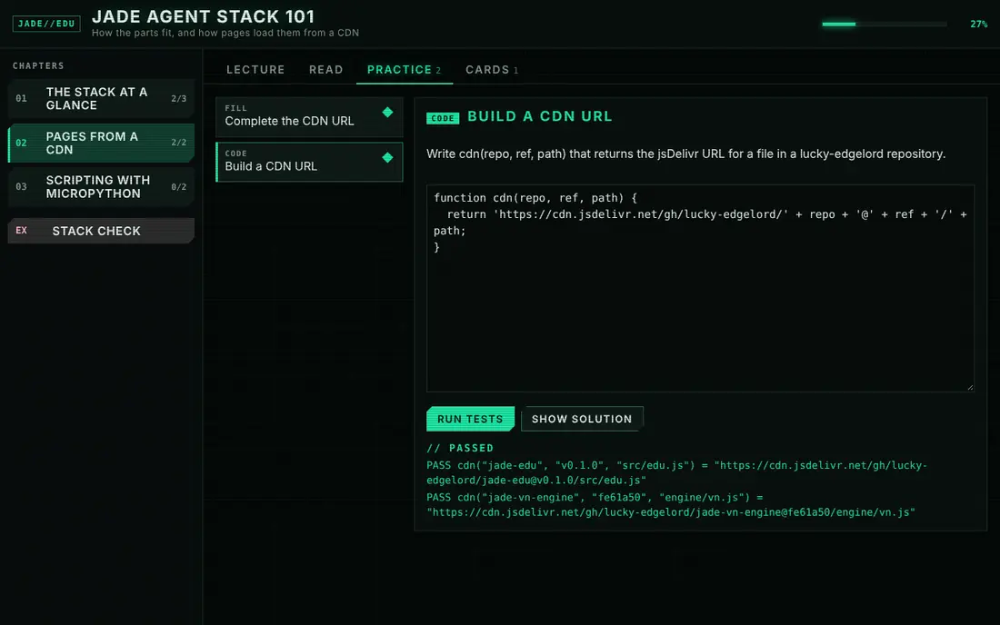<br>**Code lab**: JavaScript tests in a Worker |
| 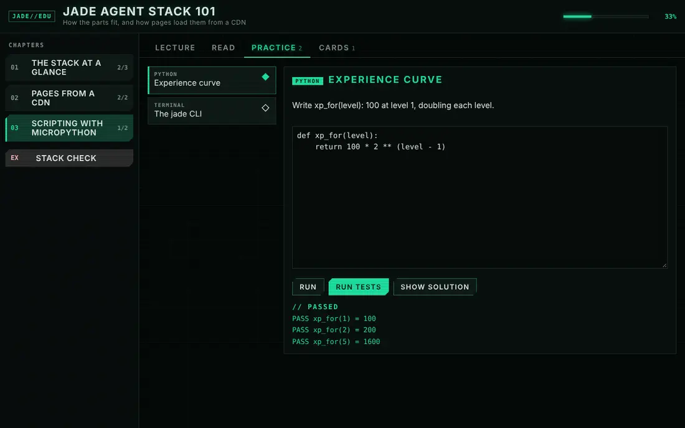<br>**Python lab**: MicroPython in the browser | 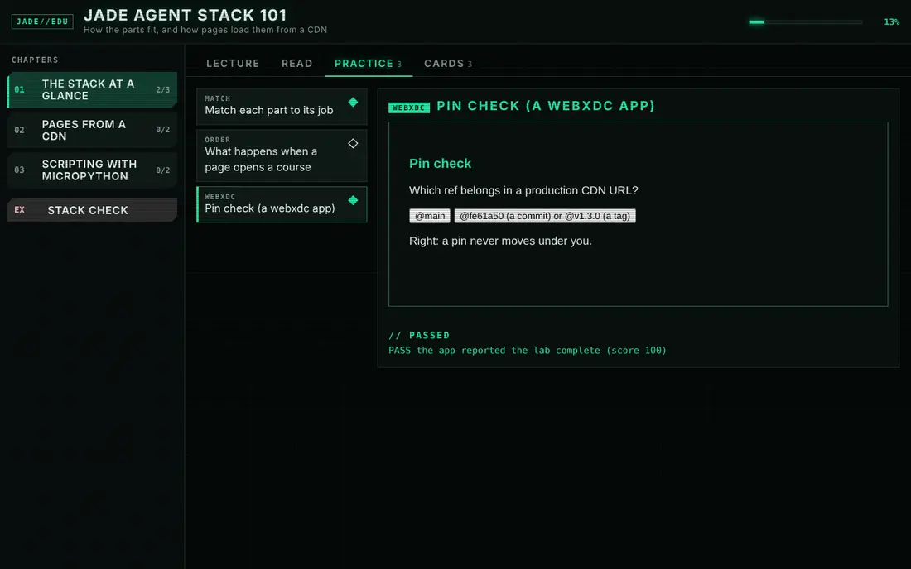<br>**Webxdc lab**: a sandboxed mini app calls `window.jade.complete()` |
| 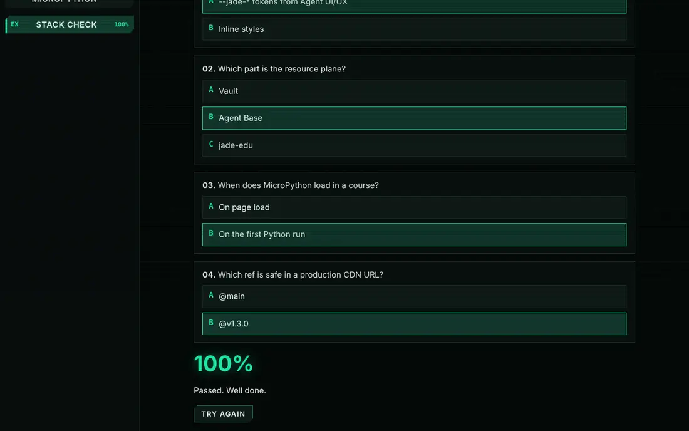<br>**Final exam** | 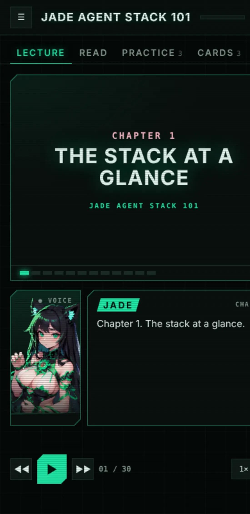<br>**Phone**: the rail becomes a menu |

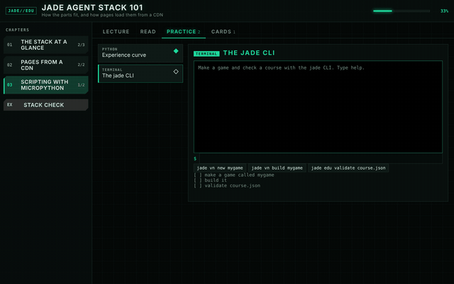

| Jade (default) | No teacher | Live2D (jade-vn-engine) |
|---|---|---|
|  | 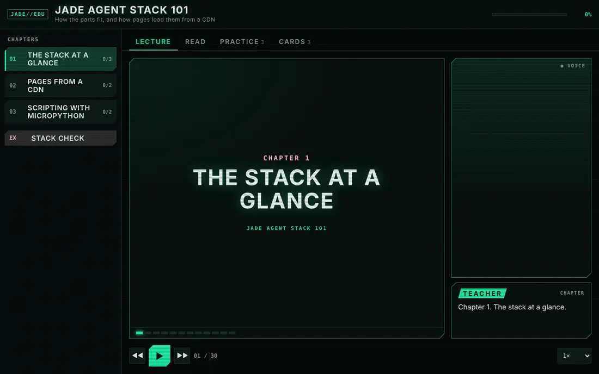 | 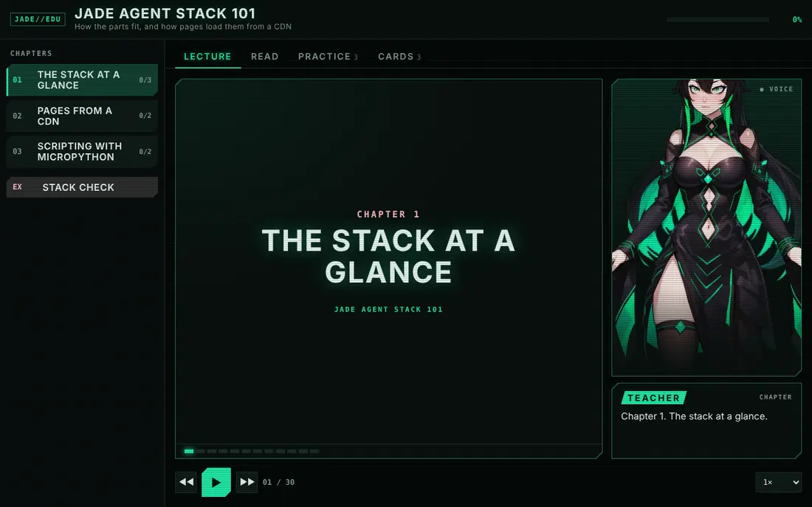 |


## Teachers

A teacher is `{ el, name, start, stop, emotion(e), speaking(on), word(), destroy }`. The built-in ones:

- **`jade`**: four WebP frames for each of the expressions neutral, happy, sad, mad and shy. The frames are:
  1. eyes open, mouth shut
  2. eyes open, mouth open
  3. eyes shut, mouth shut
  4. eyes shut, mouth open
- **`sprite`**: the same frame scheme with your own art: `{ kind: 'sprite', name, base: 'https://…/frames/', ext: 'png' }`, or `frames: (emotion, n) => url`.
- **`live2d`**: a Live2D model drawn by jade-vn-engine's renderer. It has lip-sync and eyes that follow the pointer, and maps emotions to expressions and motions: `{ kind: 'live2d', model, core, expressions: { happy: 'F01' }, motions: { happy: 'TapBody' } }`.
  - The Cubism Core is Live2D's proprietary runtime and is not shipped. Using it means accepting Live2D's licence.
- **`none`**: captions only.
- **Your own**: `registerTeacher('robot', async (o) => ({ el, name: 'Robo', start() {}, … }))`.

## Look

The player uses Jade's Vault netrunner UI:

- a dark jade grid with scanlines
- cut corners and a glowing accent
- uppercase display type

Every colour, font and the corner size reads the `--jade-*` tokens of
[jade-agent-ui-ux](https://github.com/lucky-edgelord/jade-agent-ui-ux) first. So a page themed with the stack (`setTheme(...)` there, or `useStackTheme()` here) restyles courses too, light mode included.

## The course format

One JSON object (`"format": "jade-course", "version": 1`):

```jsonc
{
  "format": "jade-course", "version": 1, "id": "my-course", "title": "…", "subtitle": "…", "author": "…",
  "teacher": "jade", "pronounce": { "CDN": "C D N" }, "images": { "fig.svg": "<svg …>" },
  "chapters": [{
    "title": "…",
    "maps": [{ "title": "…", "links": ["A | relation | B", "B [ch2] | links to | chapter 2"] }],
    "summary": ["…"], "keyPoints": ["…"], "glossary": [{ "term": "…", "def": "…" }],
    "lesson": [ "text", { "type": "code", "lang": "js", "code": "…" }, { "type": "table", "title": "…", "head": […], "rows": [[…]] },
                { "type": "figure", "image": "fig.svg", "caption": "…" }, { "type": "math", "tex": "e^{i\\pi}+1=0" }, { "type": "map", "title": "…", "links": […] } ],
    "references": [{ "title": "…", "url": "https://…", "note": "…" }],
    "quiz": [{ "q": "…", "options": ["…", "…"], "answer": 1, "explain": "…" }],
    "cards": [{ "q": "…", "a": "…" }],
    "practice": [ /* labs */ ]
  }],
  "finalExam": { "title": "…", "passMark": 70, "size": 20, "questions": [ /* quiz questions */ ] }
}
```

Text can contain `**bold**`, `` `code` `` and math in `$…$`, `$$…$$`, `\(…\)` or `\[…\]`.

| Lab type | Fields |
| --- | --- |
| `fill` | `text` with `{{answer}}` or `{{a\|b}}` blanks |
| `order` | `items` in the right order (shown shuffled) |
| `match` | `pairs`: `[[left, right], …]` |
| `write` | `prompt`, `checks`: `[{ re, msg, not }]` |
| `code` | JavaScript, run in a Worker: `fn`, `starter`, `tests`: `[{ args, expect, approx }]`, or `checkJs` |
| `python` | MicroPython, run in a Worker: `fn` + `tests`, and/or `checks` on what it prints |
| `terminal` | `prompt`, `banner`, `chips`, `vars`, `commands`: `[{ re, out, set, when, unless }]`, `tasks`: `[{ text, cmd }]` |
| `webxdc` | `xdc` (base64 .xdc), `html`, or `files`. The app calls `window.jade.complete(score)` when the learner is done |

Every lab can also have `intro`, `hint` and `solution`. `examples/stack-101.course.json` uses all of these.

Check a course:

```sh
node tools/validate.mjs validate my-course.json   # or --json, or --template for a starter
jade edu validate my-course.json                  # the same, from the jade CLI
```

## Offline webxdc

```sh
python3 tools/pack.py my-course.json my-course.xdc --python ../jade-vn-engine/engine/vendor
```

This writes the player, Jade, the course and (optionally) MicroPython into one `.xdc` that works with no network. The example is about 1.6 MB, mostly Jade's frames.

## Develop

```sh
npm install
node tests/core.test.mjs                                    # pure modules, plus Python if ENGINE is set
CHROME=/usr/bin/google-chrome node tests/player.test.mjs   # the player in a browser
```

The tests look for a jade-vn-engine checkout at `../vn-engine/engine`, or at `ENGINE=…`. They use it for MicroPython and the Live2D renderer. Screenshots go to `tests/out/`.

Run `python3 tools/port.py <Lilith-Learning-Lab>/build/src` to re-port the pure modules after Lilith changes. The modules are committed, so the CDN serves them as they are.

## Licence

The code is MIT. Jade's artwork in `assets/jade/` belongs to the repository owner and is for use with the Jade Agent Stack; ask before you reuse it elsewhere.
